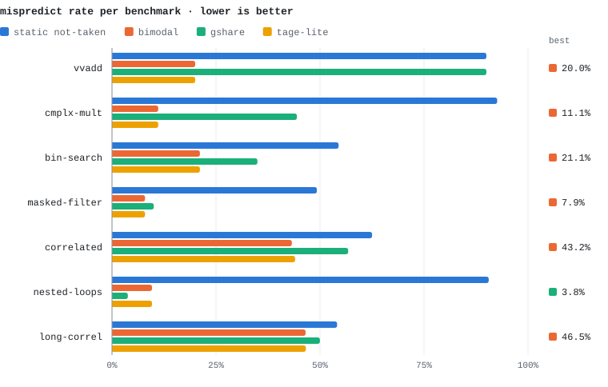
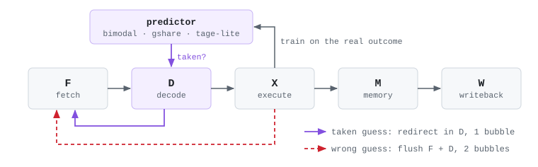

# riscv-branch-predictors

three dynamic branch predictors (bimodal, gshare, tage-lite) dropped into a 5-stage rv32im pipeline in verilog, then raced against a static not-taken baseline on seven microbenchmarks.

final project for ece 475 (computer architecture) at princeton, built with janardhan raghunathan.

<picture>
  <source media="(prefers-color-scheme: dark)" srcset="docs/mispredicts-dark.svg">
  
</picture>

## tl;dr

- **gshare takes `nested-loops` from 90.6% mispredicts to 3.8%.** bimodal gets `masked-filter` from 49.3% to 7.9%.
- **ipc barely moves:** +1.8% on `nested-loops`, +4.6% at best (`bin-search`).
- on `long-correl` the predictors miss *less* than the baseline (46.5% vs 54.1%) and still run 2.4% *slower*.

all three come from the same thing: where the prediction happens.

## where the guess happens

<picture>
  <source media="(prefers-color-scheme: dark)" srcset="docs/pipeline-dark.svg">
  
</picture>

there's no btb, so the branch target isn't known until **decode**. the predictor is read in D, and a "taken" guess redirects the pc from there. that costs one bubble even when the guess is right. branches resolve in X, so a wrong guess flushes F and D for two bubbles.

```math
\text{bubbles} = 1 \cdot N_{\text{correct taken guesses}} + 2 \cdot N_{\text{mispredicts}}
```

the baseline guesses not-taken, which is free when it's right and costs 2 when the branch is taken. so a predictor saves at most **1 cycle per taken branch, not 2**. on `nested-loops` gshare removes 478 mispredicts and saves 477 cycles, almost exactly 1 cycle each.

it's also why `long-correl` gets slower. its branches are close to coin flips, and every wrong "taken" guess now costs 2 cycles where the baseline's not-taken guess cost 0. fetch-stage prediction with a btb is the obvious next step.

## the predictors

| predictor | state | index |
| --- | --- | --- |
| static not-taken (`riscvlong`) | none | n/a |
| bimodal (`riscvbt`) | 1024 × 2-bit counters | $\text{pc}[11{:}2]$ |
| gshare (`riscvgshare`) | 1024 × 2-bit counters + 10-bit ghr | $\text{pc}[11{:}2] \oplus \text{ghr}$ |
| tage-lite (`riscvtage`) | 256-entry bimodal T0 + 256-entry tagged T1 (3-bit counters, 8-bit tags, a useful bit) + 8-bit ghr | T1: $\text{pc}[9{:}2] \oplus \text{ghr}$, tag: $\text{pc}[17{:}10] \oplus \text{rot}(\text{ghr})$ |

all counters reset to weakly not-taken. tage-lite predicts from T1 when its tag matches and falls back to T0 otherwise. on a mispredict it allocates into T1 unless the entry is marked useful, in which case it clears the useful bit first.

two results i didn't expect:

- **tage-lite ties bimodal on 5 of 7 benchmarks.** on runs this short, T1 rarely gets a confident hit, so T0 (a plain bimodal table) makes nearly every call.
- **gshare loses on `correlated`**, the benchmark written to make it win (56.8% vs bimodal's 43.2%). the data is random, so 10 bits of history mostly spread each branch across counters that never get enough samples to train.

## all the numbers

| benchmark | static not-taken | bimodal | gshare | tage-lite | best ipc vs baseline |
| --- | ---: | ---: | ---: | ---: | ---: |
| vvadd | 90.0% | **20.0%** | 90.0% | **20.0%** | 0.962 → 0.974 |
| cmplx-mult | 92.6% | **11.1%** | 44.4% | **11.1%** | 0.725 → 0.732 |
| bin-search | 54.5% | **21.1%** | 35.0% | **21.1%** | 0.720 → 0.753 |
| masked-filter | 49.3% | **7.9%** | 10.0% | **7.9%** | 0.782 → 0.814 |
| correlated | 62.5% | **43.2%** | 56.8% | 44.0% | 0.848 → 0.846 |
| nested-loops | 90.6% | 9.6% | **3.8%** | 9.6% | 0.775 → 0.790 |
| long-correl | 54.1% | **46.5%** | 50.0% | 46.6% | 0.690 → 0.673 |

raw counts (cycles, instructions, branches, mispredicts) are in [`build/results.csv`](build/results.csv).

## run it

needs [icarus verilog](https://steveicarus.github.io/iverilog/). the test and benchmark images are prebuilt, so you don't need a riscv toolchain.

```bash
cd build
make check-asm-riscvgshare     # riscv isa tests on the gshare core
make run-bmark-riscvgshare     # the seven microbenchmarks
./gather-stats.sh > results.csv
```

swap `gshare` for `bt`, `tage` or `long` to run the other cores. the benchmark sources (and the python scripts that generate `nested-loops`, `long-correl` and `correlated`) are in [`ubmark/ubmark/`](ubmark/ubmark).

## what's where

| path | what |
| --- | --- |
| `riscvlong/` | baseline 5-stage bypassed pipeline with pipelined mul/div, static not-taken |
| `riscvbt/` | + bimodal predictor (`riscvbt-BHT.v`) |
| `riscvgshare/` | + gshare (`riscvgshare-gshare.v`) |
| `riscvtage/` | + tage-lite (`riscvtage-tage.v`) |
| `riscvstall/`, `riscvbyp/`, `riscvdualfetch/`, `riscvssc/` | earlier pipelines from the course: stall-only, bypassing, dual fetch, 2-wide superscalar |
| `ubmark/` | microbenchmarks |
| `tests/` | riscv assembly tests |
| `build/` | makefile, stats script, results |

janardhan wrote the tage-lite table and much of the superscalar scoreboard. i did bimodal, gshare, the benchmarks and the stats pipeline.
